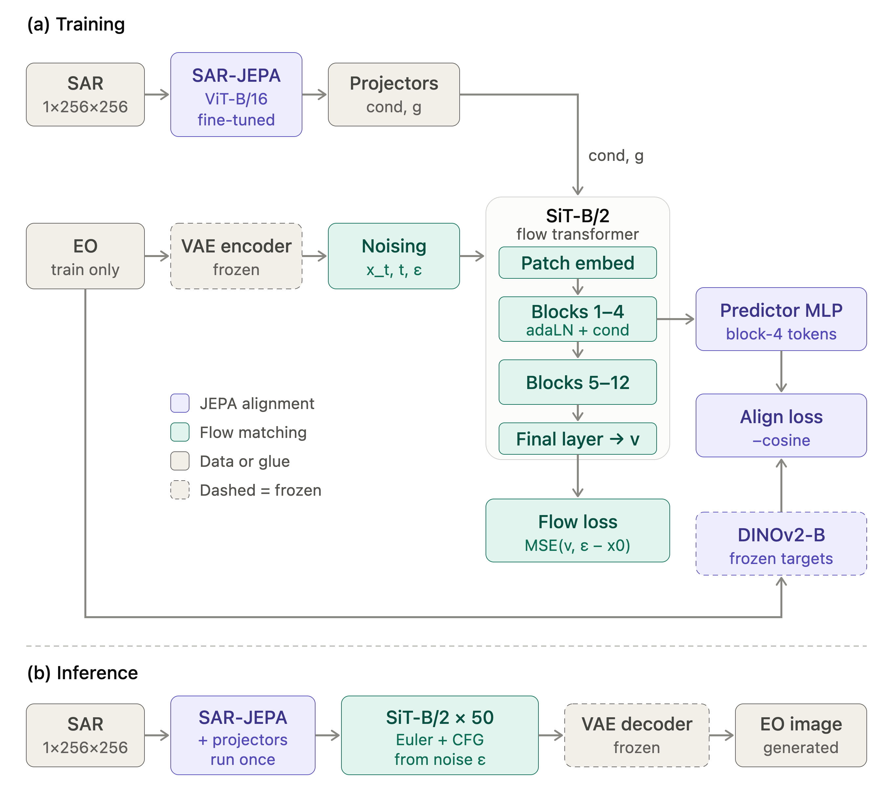

# SAR-to-EO Image Translation

SAR-to-EO is a conditional generative model that translates single-channel
Synthetic Aperture Radar (SAR) images into corresponding RGB optical
images. The project is designed for paired SAR and Earth-observation imagery
from the SEN1-2 dataset.



## Architecture

The model consists of four main components:

1. **SAR encoder** - A SAR-JEPA/LoMaR ViT-B/16 encoder extracts spatial
   features from the input SAR image.
2. **Conditioning projections** - SAR token features and global features are
   projected into the latent flow-transformer representation.
3. **Latent flow transformer** - A SiT-B/2 backbone operates on SD-VAE latent
   representations and predicts the flow velocity needed to generate the EO
   image.
4. **Frozen target encoders** - SD-VAE provides image latents, while DINOv2
   provides semantic image representations for training targets.

Training combines flow-matching loss with a DINOv2 representation-alignment
loss. The SAR-JEPA encoder and the target VAE/DINOv2 models are initialized
from pretrained checkpoints.

## Setup

Clone the repository and install the dependencies:

```bash
git clone https://github.com/newblitz/sar_to_eo
cd sar_to_eo
pip install -r requirements.txt
```


## Results

The current reported results are:

| Metric | Score |
|---|---:|
| PSNR | 12.90 dB |
| LPIPS | 0.4797 |
| FID | 82.81 |
| SSIM| 0.1652 |
